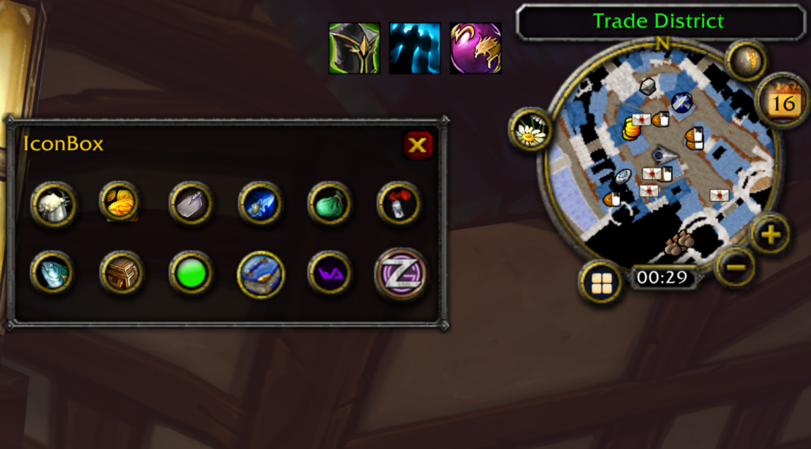
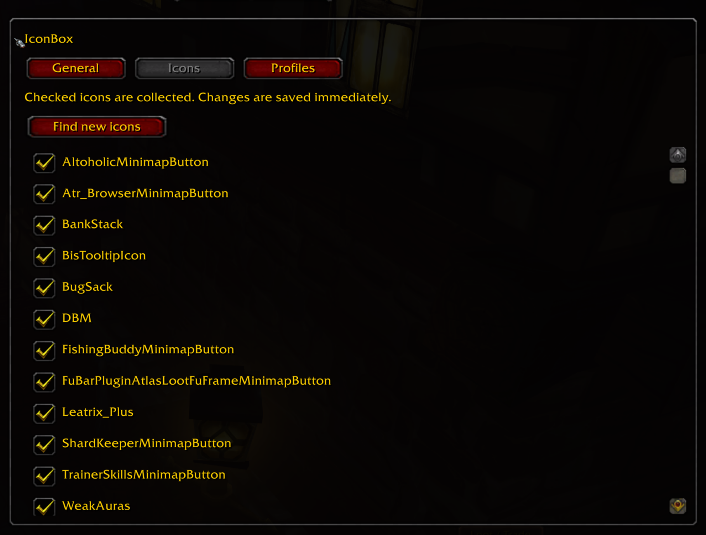

# IconBox-WotLK

**Your addon buttons, together in one box.**

IconBox is a minimap button collector for **World of Warcraft: Wrath of the Lich King 3.3.5a**. It gathers supported addon buttons into a compact drawer, leaving one IconBox button on your minimap. Choose which icons to collect, arrange the drawer to suit your UI, and keep the rest where you want them.

IconBox works on its own and automatically adopts ElvUI styling when ElvUI is installed. **ElvUI is optional.**

## Screenshots

<a href="docs/screenshots/default-wow.png"></a>

*Standard WoW interface — a classic frame and familiar minimap buttons, collected into one drawer.*

<a href="docs/screenshots/elvui.png"></a>

*ElvUI interface — a clean panel that matches ElvUI, with support for a square minimap.*

## Features

- **One minimap launcher:** open a drawer containing your collected addon buttons.
- **Choose your icons:** check the buttons you want inside; leave the others at the minimap.
- **Automatic discovery:** looks for new supported buttons every three seconds outside combat, with a manual scan available in settings.
- **Original button actions:** keeps the collected buttons' click handlers and tooltips.
- **Flexible layout:** choose 1–10 columns; the drawer resizes to fit its contents.
- **Left or down:** choose where the drawer opens relative to its launcher.
- **Precise positioning:** adjust horizontal and vertical offsets with sliders or exact pixel values.
- **Transparent or opaque background:** change the panel background without fading the icons or text.
- **Native WoW and ElvUI styling:** panels, fonts and controls adapt to your interface.
- **Movable launcher:** drag it around round, square and supported mixed-shape minimaps.
- **Smooth transitions:** the drawer fades in and out, and closes after selecting an icon.
- **Shared or personal profiles:** share settings across characters or use a separate profile for each character and realm.
- **Collector conflict check:** detects ElvUI Enhanced Button Grabber and lets you choose which collector to use.
- **Built-in settings:** configure everything through Interface Options; no chat commands required.

## Installation

1. Download the repository ZIP using **Code → Download ZIP**, then extract it.
2. Rename the extracted `IconBox-WotLK-main` folder to **`IconBox`**. If you downloaded a different branch, the suffix may differ.
3. Copy that folder into your WoW client's **`Interface/AddOns/`** directory.
4. Check that the file structure is exactly:

   ```text
   World of Warcraft/
   └── Interface/
       └── AddOns/
           └── IconBox/
               ├── IconBox.toc
               ├── IconBox.lua
               └── Textures/
                   └── IconBox.tga
   ```

5. Start WoW and enable **IconBox** in the character selection screen's **AddOns** list.

**Keep the addon folder named `IconBox`.** The GitHub repository is named `IconBox-WotLK`, but the in-game texture paths use `IconBox`. Avoid an extra nested folder such as `AddOns/IconBox/IconBox-WotLK-main/`.

If ElvUI Enhanced Button Grabber is active, IconBox pauses collection and offers a choice. **Use IconBox** disables ElvUI Enhanced's grabber; **Use ElvUI Grabber** pauses IconBox. Either choice reloads the UI so the collectors do not compete.

## How to use

| Action | Result |
| --- | --- |
| Left-click the IconBox minimap button | Open or close the drawer |
| Shift + right-click the IconBox minimap button | Open IconBox settings |
| Drag the IconBox minimap button | Move the launcher around the minimap |
| Click a collected addon button | Run its normal action and close the drawer |
| Press Escape or use the drawer's close button | Close the drawer |

You can always open settings through **Esc → Interface → AddOns → IconBox**, including when IconBox is paused and its launcher is hidden.

## Settings

### General

Enable or pause collection, toggle the transparent background, choose **Down** or **Left**, and set the number of columns. Horizontal and vertical offsets range from **−500 to +500 pixels**:

- **Horizontal:** negative moves left; positive moves right.
- **Vertical:** negative moves down; positive moves up.

Use the sliders or enter exact values. **Preview box** opens the drawer while keeping settings visible. **Reset layout** restores the default layout without changing your selected icons or profile mode.

<a href="docs/screenshots/settings-general.png"></a>

*General settings — adjust the drawer's appearance and position, then preview your changes.*

### Icons

Check a button to collect it, or uncheck it to return it to the minimap. **Find new icons** runs a manual scan. Changes are saved immediately.

<a href="docs/screenshots/settings-icons.png"></a>

*Icon selection — keep the buttons you use together and leave individual icons at the minimap.*

### Profiles

**Share settings across all characters** is enabled by default. Uncheck it to use a personal profile for the current character and realm.

Profiles include the layout, selected icons, enabled state and launcher position. Your first personal profile copies the shared settings. Switching back and forth preserves both profiles.

Changes save immediately. Switch profiles, enable or disable collection, and change icon selections **outside combat**. Drawer layout changes made during combat take effect after combat ends.

## Updating

1. Exit WoW and download the latest repository ZIP.
2. Extract it and rename the addon folder to **`IconBox`**, as described above.
3. Replace the old **`Interface/AddOns/IconBox/`** folder with the new one. Replacing the folder rather than merging it removes obsolete files.
4. Start WoW again.

Your profiles and settings are stored separately in WoW's **`WTF`** directory, so replacing the addon folder preserves them. Do not delete `WTF` or IconBox's SavedVariables files when updating. Back up `WTF` first if you want a copy of your settings.

## Compatibility and troubleshooting

- **Client:** WoW **3.3.5a**, Interface **30300**. This targets the original WotLK client, rather than Retail or modern Wrath Classic.
- **ElvUI:** optional. IconBox uses the skin helpers provided by a compatible installed ElvUI version.
- **Other collectors:** use only one minimap button collector at a time. The built-in popup handles ElvUI Enhanced Button Grabber; disable other collectors manually.
- **Missing button:** make sure the addon itself shows its minimap button, then use **Icons → Find new icons**. Custom buttons may need individual compatibility fixes.
- **Map controls:** built-in minimap controls, protected buttons, unnamed buttons and recognized map pins are excluded.
- **Missing launcher:** check **General → Enable IconBox** through Interface Options.
- **Missing artwork:** verify the folder is named **`IconBox`** and contains **`Textures/IconBox.tga`**.

When reporting a problem, include your client version, ElvUI version if used, the affected addon/button, steps to reproduce, and any Lua error text. A screenshot of the layout is helpful too.

## Development checks

From the repository root, use Lua 5.4 for the headless tests and Lua 5.1 for client-compatible syntax checks:

```sh
luac5.1 -p IconBox.lua
lua5.4 tests/test_layout.lua
lua5.4 tests/test_conflict.lua
lua5.4 tests/test_settings.lua
lua5.4 tests/test_settings.lua elvui
```

The headless tests cover layout, settings, profiles and collector conflict handling. Visual appearance and addon-specific button behavior should also be tested in the 3.3.5a game client.
