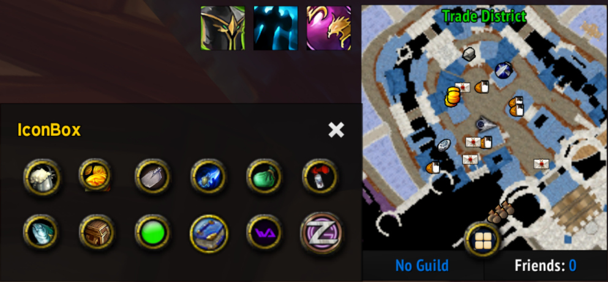
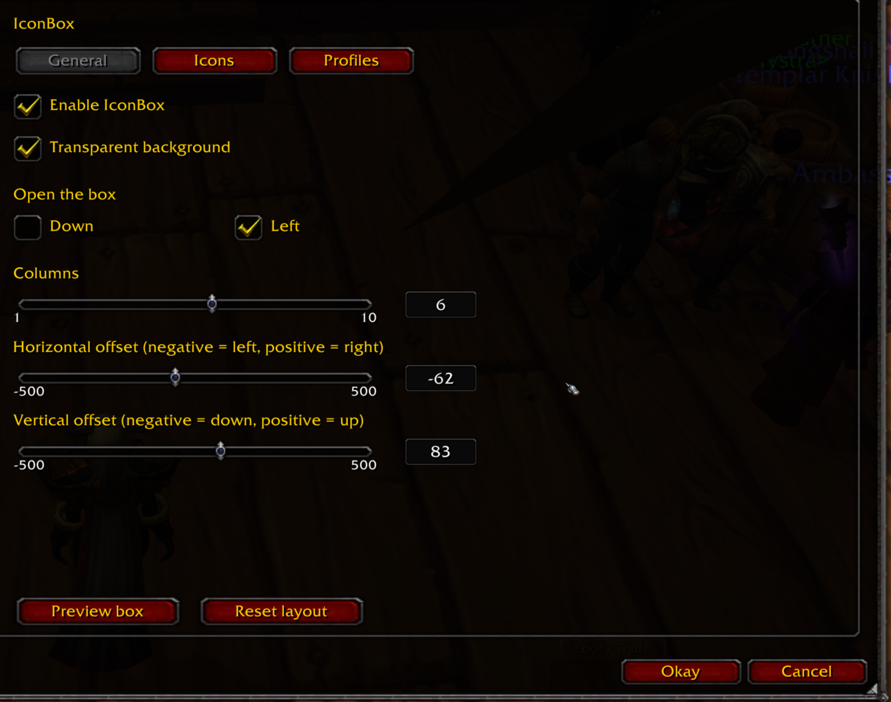

  

# IconBox

A minimap button collector for **WoW 3.3.5a (WotLK)**. Gather your addon buttons into one compact box and choose which icons stay at the minimap.

[**Download the latest version**](https://github.com/andreash-dev/IconBox-WotLK/archive/refs/heads/main.zip)

- **Choose which icons to collect** with individual checkboxes.
- **Adjust the layout:** 1–10 columns, open left or down, and precise X/Y offsets.
- **Transparent or solid background**, with smooth opening and closing animations.
- **Works with the default WoW UI and ElvUI**, with automatic ElvUI styling.
- **Shared or character-specific profiles**, including layout and selected icons.
- **Round and square minimap support. No required dependencies.**

## Screenshots

### ElvUI

*Collected addon buttons in a clean ElvUI-styled box.*

### Original WoW UI

*A classic WoW frame beside the standard minimap.*

Settings screenshots

*General — appearance, opening direction, columns and pixel offsets.*

*Icons — choose which addon buttons belong in the box.*

## Controls

| Action | Control |
| --- | --- |
| Open / close the box | Left-click the minimap icon |
| Open settings | Shift + right-click the minimap icon, or Esc → Interface → AddOns → IconBox |
| Move the minimap icon | Left-drag |
| Use an addon button | Click its icon; the box closes automatically |

## Installation

1. Download the ZIP using the link above and extract it. Rename `IconBox-WotLK-main` to **`IconBox`**.
2. Place the `IconBox` folder in `World of Warcraft/Interface/AddOns/`.
3. Restart WoW and enable IconBox in the AddOns list.

When updating, replace the existing `IconBox` folder. Your saved settings are retained.

## Compatibility

- **Client:** WoW 3.3.5a, interface 30300. Tested in-game on Warmane.
- **Interface:** standard WoW UI or ElvUI.
- **Settings:** shared across characters on the same account, or separate for each character and realm.

If ElvUI Enhanced Button Grabber is active, a popup lets you choose which collector to use. Other button collectors should be disabled manually. Some custom addon buttons may need individual compatibility fixes.

Found a problem? [Open an issue](https://github.com/andreash-dev/IconBox-WotLK/issues) with your client, UI setup and steps to reproduce it.
